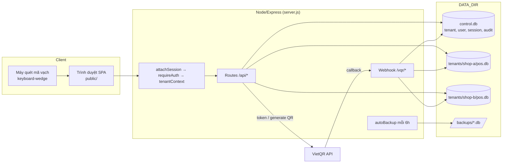
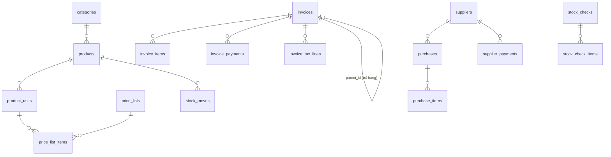
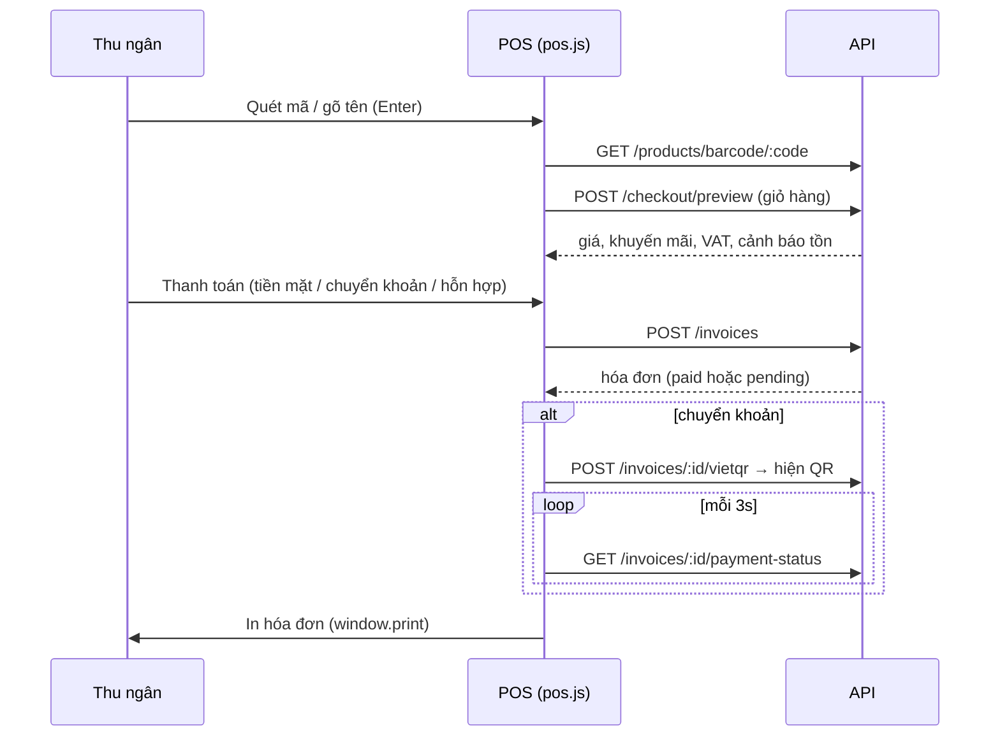
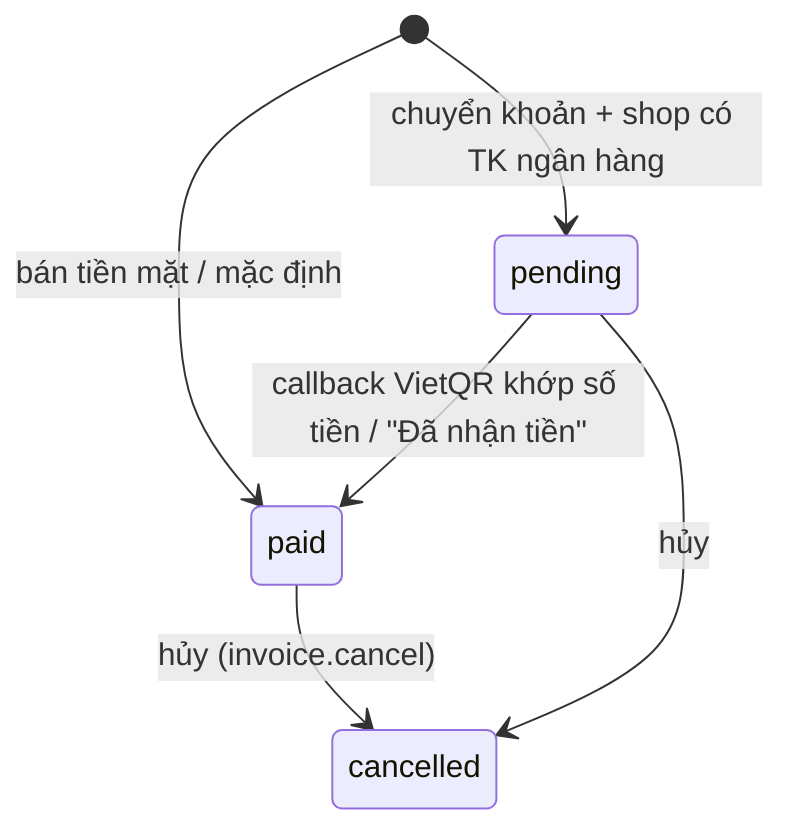

# Thiết kế kỹ thuật – POS Shop (SaaS đa cửa hàng)

> Tài liệu thiết kế hệ thống **theo hiện trạng mã nguồn** (as-built, cập nhật 28/09/2026), kèm định hướng cho các phần chưa làm.
> Lộ trình & tiến độ xem [`ROADMAP.md`](./ROADMAP.md); kế hoạch gia cố bảo mật xem [`PLAN-HARDENING.md`](./PLAN-HARDENING.md).

**Ký hiệu trạng thái:** ✅ đã triển khai · 🟡 triển khai một phần · ⏳ kế hoạch, chưa có mã

## Mục lục
1. [Tổng quan & nguyên tắc](#1-tổng-quan--nguyên-tắc)
2. [Stack công nghệ](#2-stack-công-nghệ)
3. [Kiến trúc tổng thể](#3-kiến-trúc-tổng-thể)
4. [Đa tenant (multi-tenancy)](#4-đa-tenant-multi-tenancy)
5. [Xác thực & phân quyền](#5-xác-thực--phân-quyền)
6. [Mô hình dữ liệu](#6-mô-hình-dữ-liệu)
7. [Nghiệp vụ bán hàng](#7-nghiệp-vụ-bán-hàng)
8. [Kho, nhà cung cấp & mua hàng](#8-kho-nhà-cung-cấp--mua-hàng)
9. [Giá, khuyến mãi & VAT](#9-giá-khuyến-mãi--vat)
10. [Thanh toán VietQR](#10-thanh-toán-vietqr)
11. [Hóa đơn điện tử](#11-hóa-đơn-điện-tử)
12. [Báo cáo & phân tích](#12-báo-cáo--phân-tích)
13. [Sao lưu & phục hồi](#13-sao-lưu--phục-hồi)
14. [Bề mặt API](#14-bề-mặt-api)
15. [Kiến trúc frontend](#15-kiến-trúc-frontend)
16. [Triển khai & vận hành](#16-triển-khai--vận-hành)
17. [Bảo mật](#17-bảo-mật)
18. [Kiểm thử](#18-kiểm-thử)
19. [Hạn chế đã biết & hướng phát triển](#19-hạn-chế-đã-biết--hướng-phát-triển)
20. [Phụ lục](#20-phụ-lục)

---

## 1. Tổng quan & nguyên tắc

POS Shop là phần mềm bán hàng & quản lý kho cho cửa hàng tạp hóa/gia dụng, chạy dạng **SaaS nhiều cửa hàng trên một máy chủ, một đường dẫn đăng nhập**. Có thể chạy trong mạng LAN (không cần internet) hoặc trên VPS công khai (bắt buộc khi dùng webhook VietQR).

Nguyên tắc thiết kế:

1. **Cách ly dữ liệu là trên hết.** Mỗi cửa hàng một file SQLite riêng; request chỉ được truy cập DB của tenant gắn với phiên đăng nhập.
2. **Phân quyền thực thi ở server.** Dữ liệu nhạy cảm (giá vốn, lợi nhuận) bị lọc ở API, không ẩn bằng CSS.
3. **Tối giản phụ thuộc.** Chỉ 2 dependency runtime (`express`, `qrcode`). SQLite, băm mật khẩu, ghi file Excel đều dùng module có sẵn của Node hoặc tự viết.
4. **Không build frontend.** SPA dùng ES modules thuần, phục vụ tĩnh.
5. **Idempotent với sự kiện ngoài.** Callback thanh toán có thể trùng; xử lý theo khoá `transactionid`.
6. **Không phá dữ liệu.** Migration chỉ thêm bảng/cột; phục hồi backup luôn giữ lại bản DB cũ.
7. **Adapter cho dịch vụ ngoài.** VietQR đi qua một client riêng (có chế độ mock); HĐĐT sẽ theo cùng hướng.

---

## 2. Stack công nghệ

| Lớp | Hiện tại | Ghi chú |
|---|---|---|
| Runtime | Node.js 22 (Docker `node:22-alpine`) | CommonJS |
| Web framework | Express 5 | Body JSON tối đa 8 MB |
| CSDL | **SQLite qua `node:sqlite` (`DatabaseSync`)** | Built-in của Node, không cần cài DB. WAL + foreign keys |
| Truy cập DB | Câu lệnh chuẩn bị (`prepare`) trực tiếp, định tuyến tenant bằng `AsyncLocalStorage` | Không ORM |
| Phiên đăng nhập | Cookie `httpOnly` + bảng `sessions` (token băm SHA-256) | Thu hồi được |
| Băm mật khẩu/PIN | `crypto.scryptSync` (salt 16 byte, key 64 byte) | So sánh thời gian hằng |
| QR | `qrcode` + tự sinh payload EMVCo/NAPAS | |
| Excel | Bộ ghi `.xlsx` tự viết (`src/lib/xlsx.js`) | Không phụ thuộc thư viện |
| Frontend | Vanilla ES modules + CSS thuần | Không build |
| Triển khai | Docker Compose + Caddy (SSL tự động) hoặc Nginx ngoài | |
| Kiểm thử | Test API tự viết (`fetch`) + Playwright UI | |

> Định hướng cũ chuyển sang PostgreSQL + RLS + Redis **chưa thực hiện** (⏳). Mô hình SQLite-mỗi-tenant đang đáp ứng quy mô hiện tại; xem [§19](#19-hạn-chế-đã-biết--hướng-phát-triển).

---

## 3. Kiến trúc tổng thể



### 3.1 Thứ tự middleware (`server.js`)
1. Static `public/`, `GET /api/health` (công khai).
2. `/vqr` — webhook VietQR, **mount trước** xác thực phiên.
3. `attachSession` — đọc cookie, nạp `req.user`, `req.tenant`, `req.permissions`.
4. `/api/auth` — đăng nhập/đăng xuất/`me`/đổi mật khẩu.
5. `requireAuth` — 401 nếu chưa đăng nhập; 403 nếu tenant `suspended`.
6. `tenantContext` — chạy phần còn lại của request trong `db.runWith(tenant.code)`.
7. `/api/platform` — chỉ quản trị nền tảng.
8. Chặn tài khoản `platform` khỏi mọi API nghiệp vụ cửa hàng.
9. Các router nghiệp vụ: `users, admin, backup, vietqr, catalog, sales, inventory, reports`.
10. 404 cho `/api/*`; bộ xử lý lỗi trung tâm dùng `ApiError.code`.

### 3.2 Cấu trúc mã nguồn
```
server.js                 khởi động, thứ tự middleware, lịch backup, in địa chỉ LAN
src/
  control.js              control DB: tenants, plans, users, sessions, audit_logs, qr_orders
  db.js                   DB từng tenant: schema, migration cộng dồn, seed, AsyncLocalStorage
  middleware.js           attachSession, requireAuth, tenantContext, requirePerm
  lib/
    auth.js               scrypt, cookie phiên
    rbac.js               vai trò, mã quyền, kiểm tra wildcard
    pricing.js            engine giá: bảng giá, khuyến mãi, chiết khấu, VAT
    codes.js              sinh mã chứng từ PREFIXyyyymmdd-NNNN
    barcode.js            sinh EAN-13 nội bộ (tiền tố 2)
    backup.js             VACUUM INTO, xoay vòng, phục hồi theo lịch
    vietqr.js             payload EMVCo/NAPAS + CRC16
    xlsx.js               bộ ghi .xlsx tối giản
    util.js               ok/fail, ApiError, wrap, ép kiểu
  payments/vietqr.js      client VietQR (token cache, generate QR, mock)
  routes/                 auth, users, platform, admin, catalog, sales, inventory, reports, backup, vietqr
public/
  index.html, style.css   khung SPA + giao diện responsive
  js/                     app, api, store, auth, util, barcode
  js/views/               pos, products, inventory, invoices, reports, vietqr, promotions, users, settings, platform, receipt, …
test/                     run.sh, api.test.js, ui.test.js
deploy/                   Caddyfile, oneclick.sh, VPS.md, nginx
```

---

## 4. Đa tenant (multi-tenancy)

### 4.1 Mô hình ✅
**Database-per-tenant** trên SQLite:

```
DATA_DIR/
  control.db                     dữ liệu nền tảng (dùng chung)
  tenants/<code>/pos.db          dữ liệu nghiệp vụ của từng cửa hàng
  tenants/<code>/backups/*.db    bản sao lưu của cửa hàng đó
```

- `code` được chuẩn hoá (`[a-z0-9_-]`, rỗng thì là `default`) trước khi ghép đường dẫn.
- Bảng nghiệp vụ **không có cột `tenant_id`** — ranh giới cách ly là file DB.
- Tương thích ngược: nếu có `DATA_DIR/pos.db` kiểu cũ (một cửa hàng), tự chuyển vào `tenants/default/`.

### 4.2 Nhận diện tenant ✅
- Đăng nhập tại một trang chung; `username` **duy nhất toàn hệ thống** ⇒ suy ra tenant từ `users.tenant_id`.
- Phiên (`sessions`) lưu `tenant_id`; `attachSession` join `sessions → users → tenants`.
- Webhook VietQR không có phiên: nhận diện tenant từ `orderId` (bảng `qr_orders`), rồi số tài khoản ngân hàng, rồi tenant trong token (xem [§10.3](#103-chiều-vào--webhook)).

### 4.3 Thực thi cách ly ✅
- `db.getTenantDb(code)` mở và cache kết nối (`Map`) cho từng tenant.
- `db.runWith(code, fn)` dùng `AsyncLocalStorage` gắn kết nối vào ngữ cảnh request; `db.prepare/exec` luôn đi qua kết nối hiện hành.
- Tác vụ nền (backup, báo cáo nền tảng, webhook) cũng gọi `db.runWith` tường minh.
- ⚠️ Ngoài ngữ cảnh, `db.prepare` rơi về tenant `default` — mọi code mới phải chạy trong `runWith`.

### 4.4 Trạng thái & gói dịch vụ 🟡
- `tenants.status`: `active` (mặc định) | `suspended` (chặn đăng nhập và chặn cả phiên đang mở). Giá trị khác được lưu nhưng xử lý như `active`.
- `tenants.expires_at`: hết hạn ⇒ chặn **đăng nhập mới** (phiên đang mở vẫn dùng đến khi hết 12h).
- `plans`: `trial` (2 user/100 SP), `standard` (5 user/2.000 SP, 200.000đ/tháng), `pro` (30 user/20.000 SP, 500.000đ/tháng). Giới hạn `max_users`, `max_products` được kiểm tra khi tạo mới. Trường `features` mới là chuỗi mô tả, chưa dùng để bật/tắt tính năng.

---

## 5. Xác thực & phân quyền

### 5.1 Hai tầng tài khoản ✅
- **Nền tảng:** `users.tenant_id IS NULL`, `role = 'platform'` (tài khoản `root` tự tạo khi khởi động, mật khẩu từ `ROOT_PASS`). Có toàn quyền (`*`) nhưng **chỉ dùng được `/api/platform`** — bị chặn khỏi API nghiệp vụ cửa hàng.
- **Cửa hàng:** `users.tenant_id` trỏ tới tenant; vai trò theo bảng dưới. Tài khoản chủ đầu tiên được tạo khi nền tảng tạo cửa hàng.

### 5.2 Vai trò (`src/lib/rbac.js`) ✅
| Vai trò | Tên | Quyền | Hạn mức giảm giá* |
|---|---|---|---|
| `owner` | Chủ cửa hàng | `*` | 100% |
| `manager` | Quản lý | `pos.* invoice.* product.* stock.* purchase.* supplier.* report.* promo.manage backup.restore einvoice.config vietqr.config` | 100% |
| `cashier` | Thu ngân | `pos.sell pos.hold pos.discount pos.misc invoice.view invoice.print product.view stock.view report.view` | 10% |
| `sales` | Nhân viên bán hàng | `pos.sell pos.hold pos.misc invoice.view invoice.print product.view stock.view` | 5% |
| `warehouse` | Thủ kho | `stock.* purchase.* supplier.view product.view report.view` | 0 |
| `accountant` | Kế toán | `invoice.view invoice.print invoice.einvoice report.* product.view product.view_cost supplier.view einvoice.config` | 0 |
| `viewer` | Chỉ xem | `product.view stock.view invoice.view supplier.view report.view` | 0 |

\* `maxDiscount` đã khai báo nhưng **chưa được kiểm tra ở server** (⏳).

**Danh mục mã quyền:**
```
pos.sell pos.hold pos.discount pos.change_price pos.return pos.misc
invoice.view invoice.print invoice.cancel invoice.einvoice
product.view product.create product.edit product.delete product.view_cost
stock.view stock.adjust purchase.create purchase.receive stockcheck.do
supplier.view supplier.edit
report.view report.profit report.supplier report.export
promo.manage settings.edit user.manage backup.restore einvoice.config vietqr.config
```

### 5.3 Cơ chế kiểm tra ✅
- `rbac.has(list, code)`: đúng nếu danh sách chứa `*`, đúng mã, hoặc wildcard `nhóm.*`.
- Middleware `requirePerm('product.edit')` → 401/403.
- Lọc dữ liệu nhạy cảm:
  - `cost_price` bị xoá khỏi response sản phẩm nếu thiếu `product.view_cost`.
  - `profit` bị xoá khỏi `/reports/summary` và `/reports/products` nếu thiếu `report.profit`.
- 🟡 Nhiều mã quyền mới khai báo, chưa gắn vào route (xem [§17.2](#172-khoảng-trống-đã-biết)).

### 5.4 Phiên & đăng nhập ✅
- Token ngẫu nhiên 32 byte, **chỉ lưu SHA-256** trong `sessions.token_hash`.
- Cookie `pos_session`: `HttpOnly; SameSite=Lax; Path=/`, thêm `Secure` khi request là HTTPS. TTL **12 giờ**.
- Đăng xuất xoá bản ghi phiên. Tài khoản bị khoá (`active=0`) mất hiệu lực ngay ở request kế tiếp.
- Giới hạn đăng nhập sai: **10 lần / 15 phút / IP**, lưu trong bộ nhớ tiến trình (`trust proxy = 1`).
- PIN (`users.pin_hash`) được lưu bằng scrypt; luồng đăng nhập bằng PIN/khoá màn hình ⏳.

### 5.5 Nhật ký kiểm toán 🟡
`control.audit_logs(tenant_id, user_id, username, action, entity, entity_id, detail, ip, created_at)`.
Đang ghi: `login`, `login_failed`, `change_password`, `user.create|update|disable`, `tenant.create|update`. Chưa ghi: hủy hóa đơn, sửa giá, điều chỉnh kho, sao lưu/phục hồi (⏳).

---

## 6. Mô hình dữ liệu

### 6.1 Quy ước
- Tiền là **số nguyên VND** (`INTEGER`), làm tròn bằng `Math.round`.
- Số lượng là `REAL` (hỗ trợ hàng cân). Tồn kho luôn theo **đơn vị cơ bản**: `base_qty = qty × conversion`.
- Thời gian lưu chuỗi `datetime('now')` (UTC).
- Xoá sản phẩm/nhà cung cấp/người dùng là **xoá mềm** (`active = 0`).
- Mã chứng từ: `<PREFIX><YYYYMMDD>-<NNNN>` (ví dụ `HD20260928-0001`), đánh số theo ngày; an toàn nhờ Node đơn luồng và thao tác đồng bộ.

### 6.2 `control.db` (dùng chung)
```
tenants(id, code UNIQUE, name, status, plan, note, expires_at, created_at)
plans(id, code UNIQUE, name, price, cycle, max_users, max_products, features, active)
users(id, tenant_id NULL→platform, username UNIQUE, password_hash, full_name, phone, email,
      role, pin_hash, active, last_login, created_at)
sessions(token_hash PK, user_id, tenant_id, created_at, expires_at, ip, user_agent)
audit_logs(id, tenant_id, user_id, username, action, entity, entity_id, detail, ip, created_at)
platform_settings(key PK, value)         -- cấu hình VietQR dùng chung cho các shop chưa tự cấu hình
control_seqs(key PK, value)              -- bộ đếm toàn cục (mã thanh toán duy nhất liên tenant)
qr_orders(order_id PK, tenant_code, invoice_id, amount, content, bank_account, created_at)
```

### 6.3 `pos.db` (mỗi tenant)


```
categories(id, name UNIQUE, description, sort_order)
products(id, barcode UNIQUE, sku, name, category_id, unit, cost_price, sell_price, stock,
         min_stock, max_stock, location, product_type, is_weighted, allow_negative,
         warranty_months, weight, description, image, vat_rate, active, created_at, updated_at)
product_units(id, product_id, name, conversion, sell_price, barcode, is_base, sort_order)
price_lists(id, name UNIQUE, note, is_default, sort_order)
price_list_items(id, price_list_id, unit_id, price, UNIQUE(price_list_id, unit_id))
promotions(id, name, kind[order|item], discount_type[percent|amount], discount_value,
           target_type[all|category|product], target_id, min_subtotal, min_qty,
           start_date, end_date, priority, active, note, created_at)

invoices(id, code UNIQUE, type[sale|return], parent_id, subtotal, item_discount, order_discount,
         discount, net_amount, vat_amount, total, payment_method, paid_amount, change_amount,
         price_list_id, promo_order_id, payment_ref, payment_content, customer_name,
         customer_phone, note, status[paid|pending|cancelled], created_at)
invoice_items(id, invoice_id, product_id, name, barcode, unit_id, unit_name, conversion, qty,
              base_qty, price, cost_price, discount, promo_id, promo_name, line_total, note)
invoice_payments(id, invoice_id, method, amount, note, created_at)
invoice_tax_lines(id, invoice_id, rate, taxable_amount, tax_amount)
held_orders(id, code UNIQUE, label, cart_json, customer_name, customer_phone, note, total,
            item_count, created_at)

suppliers(id, name, tax_code, contact_name, phone, address, email, note, payment_terms_days,
          active, created_at)
supplier_payments(id, supplier_id, amount, method, note, paid_at, created_at)
purchases(id, code UNIQUE, supplier_id, supplier_name, note, total,
          status[draft|received|cancelled], created_at, received_at)
purchase_items(id, purchase_id, product_id, name, unit_id, unit_name, conversion, qty,
               base_qty, cost_price, line_total, vat_rate)

stock_checks(id, code UNIQUE, note, scope[all|category], category_id, status[draft|completed],
             diff_value, created_at, completed_at)
stock_check_items(id, check_id, product_id, name, unit_name, system_qty, counted_qty, diff,
                  cost_price, note)
stock_moves(id, product_id, qty(±), type[init|import|adjust|sale|return|purchase|cancel|check],
            ref_type, ref, unit_id, unit_name, conversion, stock_after, note, created_at)

vietqr_transactions(id, transactionid, invoice_id, bank_account, amount, content, order_id,
                    trans_type[C|D], matched, note, raw_json, created_at)
settings(key PK, value)
```

### 6.4 Migration ✅
Không có bảng phiên bản. Mỗi lần mở kết nối tenant, `ensureSchema` chạy:
1. `CREATE TABLE/INDEX IF NOT EXISTS` cho toàn bộ bảng.
2. `ensureColumn` / `ensureColumnWithDefault`: đọc `PRAGMA table_info`, `ALTER TABLE ADD COLUMN` nếu thiếu, backfill khi cần.
3. Seed nếu trống: cài đặt mặc định, 6 danh mục, 2 bảng giá (lẻ/buôn), đơn vị cơ bản cho mọi sản phẩm. Sản phẩm & khuyến mãi mẫu chỉ cho tenant `default`.

`control.db` dùng cùng cách (cộng dồn cột). Quy tắc: **chỉ thêm, không đổi tên/xoá cột**.

---

## 7. Nghiệp vụ bán hàng

### 7.1 Luồng POS (F1) ✅


- **Treo đơn:** `held_orders` lưu nguyên giỏ (`cart_json`) để mở lại.
- **Tra cứu mã vạch trực tuyến:** nếu không có trong kho, gọi Open Food Facts (bật/tắt bằng `online_lookup`).
- Máy quét mã vạch dạng bàn phím (kết thúc bằng Enter) nhập vào ô `#scan-input`.

### 7.2 Trạng thái hóa đơn ✅

- **Trừ tồn ngay khi tạo hóa đơn**, kể cả `pending`. Bản ghi `invoice_payments` chỉ tạo khi `paid`.
- **Hủy** hoàn tồn (hóa đơn bán: cộng lại; phiếu trả: trừ lại), ghi `stock_moves.type = cancel`. Không đảo bút toán thanh toán.

### 7.3 Trả hàng ✅
- Phiếu trả là một `invoices` với `type = 'return'`, `parent_id` trỏ hóa đơn gốc; dùng cùng engine giá, cộng lại tồn.
- `invoice_payments.amount` ghi **số âm** để báo cáo theo phương thức thanh toán tự cân.
- `GET /invoices/:id/returnable` tính số lượng còn được trả. ⚠️ Server chưa chặn trả vượt số lượng (⏳).

---

## 8. Kho, nhà cung cấp & mua hàng

### 8.1 Sổ kho ✅
Mọi biến động tồn ghi `stock_moves` với `qty` có dấu, loại, chứng từ tham chiếu và `stock_after`. Tồn không được âm trừ khi `allow_negative_stock` (cài đặt) hoặc `products.allow_negative`.

### 8.2 Giá vốn ✅
**Giá nhập gần nhất (ghi đè), không phải bình quân gia quyền.**
- Nhận phiếu nhập: `cost_price = round(giá nhập / conversion)` theo đơn vị cơ bản.
- Nhập kho thủ công có kèm giá: ghi đè `cost_price`.
- Khi bán, `cost_price` hiện hành được chụp vào `invoice_items.cost_price` để tính lợi nhuận: `line_total − cost_price × base_qty`.

### 8.3 Phiếu nhập ✅
`draft` → `received` (cộng tồn, cập nhật giá vốn) → `cancelled` (nếu đã nhận thì trừ lại tồn). Chỉ sửa/xoá khi còn `draft`.

### 8.4 Kiểm kho ✅
Tạo phiếu (toàn bộ hoặc theo danh mục) chụp `system_qty` → nhập `counted_qty` → hoàn tất: đặt tồn bằng số đếm, ghi `stock_moves.type = check`, `diff_value = Σ chênh lệch × giá vốn`.

### 8.5 Nhà cung cấp & công nợ ✅
- Hồ sơ NCC (MST, người liên hệ, điều khoản thanh toán).
- Công nợ: `Σ purchases.total (received) − Σ supplier_payments` (`GET /suppliers/payables`).
- ⏳ Trả hàng NCC, bảng giá nhập theo NCC.

---

## 9. Giá, khuyến mãi & VAT

Engine `src/lib/pricing.js → priceCart()` dùng chung cho xem trước, bán và trả hàng.

### 9.1 Giá dòng
Thứ tự ưu tiên: giá nhập tay trên dòng → giá theo **bảng giá** (`price_list_items`, theo đơn vị) → `sell_price` của đơn vị. `gross = round(price × qty)`.

### 9.2 Khuyến mãi
- Chỉ lấy khuyến mãi `active = 1` trong khoảng ngày, sắp theo `priority DESC`.
- **Theo mặt hàng** (`kind = item`): phạm vi tất cả/danh mục/sản phẩm, điều kiện `min_qty`; chọn khuyến mãi có `discount_value` lớn nhất (hoà thì theo `priority`). Phần trăm trên `gross` hoặc số tiền × số lượng; kẹp trong `[0, gross]`.
- **Theo đơn** (`kind = order`): điều kiện `min_subtotal`; chọn mức giảm thực tế lớn nhất.
- Giảm giá tay trên dòng thay thế khuyến mãi mặt hàng; giảm giá tay trên đơn cộng với khuyến mãi đơn, tổng không vượt tạm tính.

### 9.3 VAT ✅
- Cài đặt tenant: `vat_mode` = `inclusive` (mặc định, giá đã gồm thuế) | `exclusive`; `vat_default_rate`. Sản phẩm ghi đè bằng `products.vat_rate`.
- Chiết khấu đơn được phân bổ theo tỷ lệ về từng dòng trước khi tính thuế.
- inclusive: `net = round(gross / (1 + r/100))`, `vat = gross − net`.
- exclusive: `vat = round(net × r/100)`, `total = net + vat`.
- Kết quả tách theo thuế suất vào `invoice_tax_lines`. VAT đầu vào lấy từ `purchase_items.vat_rate`.
- Tham chiếu: 8% là mức giảm tạm thời đến hết **31/12/2026** (NQ 204/2025/QH15; NĐ 174/2025/NĐ-CP) — *cần kế toán xác nhận*. ⏳ Bảng thuế suất có hiệu lực theo thời gian.

---

## 10. Thanh toán VietQR

> VietQR là dịch vụ **thanh toán / biến động số dư**, khác hóa đơn điện tử.

### 10.1 Mô hình nhiều cửa hàng ✅ (đã chốt)
**Mỗi cửa hàng là một merchant VietQR riêng**, tiền về thẳng tài khoản MB/BIDV của cửa hàng. Tất cả cửa hàng dùng **chung một URL webhook**; mỗi cửa hàng có cặp Basic Auth riêng và số tài khoản riêng để nhận diện. Cửa hàng chưa tự cấu hình thì kế thừa cấu hình VietQR của nền tảng (`platform_settings`).

### 10.2 Chiều ra — tạo QR động ✅
`src/payments/vietqr.js`:
- `getToken`: Basic Auth tới `{base}/vqr/api/token_generate`, **cache theo tenant** (hết hạn 300s, trừ 5s dự phòng).
- `generateQR`: Bearer tới `/vqr/api/qr/generate-customer` với `amount, orderId, content, bankCode, bankAccount, terminalCode…`.
- Môi trường: `mock` (tự sinh QR NAPAS cục bộ, không gọi mạng) | `dev` (`https://dev.vietqr.org`) | `prod` (`https://api.vietqr.org`; bắt buộc khi `NODE_ENV=production`).
- `payment_ref` (mã ngắn ≤13 ký tự, dạng `P##########`, duy nhất liên tenant nhờ `control_seqs`) làm `orderId`; `content` ≤23 ký tự không dấu. Ánh xạ `orderId → tenant, invoice` lưu ở `control.qr_orders`.

### 10.3 Chiều vào — webhook ✅
Mount tại `/vqr`, công khai, không dùng phiên:

| Endpoint | Xác thực | Xử lý |
|---|---|---|
| `POST /vqr/api/token_generate` | Basic Auth (cặp của từng shop hoặc `VQR_EXPOSED_USER/PASS`) | Trả `{access_token, token_type:"Bearer", expires_in:300}`; token = `base64url(payload).HMAC-SHA256` ký bằng `VQR_SECRET` |
| `POST /vqr/bank/api/transaction-sync` | Bearer | Xác định tenant → `processPayment` → `{error, errorReason, toastMessage, object:{reftransactionid}}` |

Xác định tenant theo thứ tự: `qr_orders[orderId].tenant_code` → quét tenant có `bank_account` trùng → tenant trong token.

### 10.4 Đối soát (`processPayment`) ✅
1. Đã có `vietqr_transactions.transactionid` ⇒ trả kết quả cũ (**idempotent**).
2. Tìm hóa đơn bán: `payment_ref = orderId` → `payment_ref = content` → regex `P\d{10}` trong `orderId + content`.
3. `amount ≠ total` ⇒ **không tự xác nhận**, lưu `matched = 0` với ghi chú "Số tiền không khớp".
4. Khớp ⇒ hóa đơn `paid`, thêm `invoice_payments` (nếu chưa có), lưu `vietqr_transactions` kèm `raw_json`.

### 10.5 Module "Giao dịch VietQR" ✅
Gộp `qr_orders` (QR đã tạo) và `vietqr_transactions` (callback thực) thành một bảng đối soát với trạng thái `success | pending | unmatched | refund` (`trans_type = D`). Lọc theo tài khoản, trạng thái, mã tham chiếu/mã đơn/nội dung, khoảng ngày; 4 thẻ thống kê; xuất Excel. Mặc định chọn tài khoản ngân hàng của cửa hàng.

### 10.6 Kiểm thử không cần VietQR ✅
- `POST /api/vietqr/simulate`: gọi thẳng `processPayment` (mock).
- `POST /api/vietqr/simulate-dev`: gọi Test Callback thật của VietQR (chỉ `vqr_env = dev`).
- Cả hai bị chặn khi `NODE_ENV=production`. Postman collection trong `postman/`.

---

## 11. Hóa đơn điện tử

**Trạng thái: ⏳ chưa có mã.** Chỉ có mã quyền `invoice.einvoice`, `einvoice.config` và chuỗi tính năng trong `plans.features`. Đánh giá tích hợp chi tiết (gap G1–G10, hạng mục T1–T10, ước lượng 12–14,5 ngày công) xem [`BAO-CAO-TICH-HOP-HOADON-DIENTU.md`](./BAO-CAO-TICH-HOP-HOADON-DIENTU.md).

### 11.1 Nguyên tắc pháp lý
Phần mềm **không tự phát hành** hóa đơn; phải qua nhà cung cấp được cấp phép + chữ ký số + đăng ký mẫu/ký hiệu. Loại áp dụng: **hóa đơn điện tử khởi tạo từ máy tính tiền** (TT 91/2026/TT-BTC, NĐ 254/2026/NĐ-CP, ký hiệu theo TT 32/2025/TT-BTC — *cần kế toán xác nhận*).

### 11.2 Thiết kế dự kiến
- **Adapter** `src/einvoice/` với interface `issue / adjust / replace / cancel / getStatus / downloadFiles`; chọn provider theo cài đặt tenant. Ứng viên đầu tiên: Tingo Pay/VietQR (tái sử dụng hạ tầng `token_generate` + webhook sẵn có, thêm `invoice-sync`).
- Dữ liệu cần thêm: bảng `einvoices(invoice_id, provider, status, provider_invoice_no, lookup_code, template_code, serial, xml_path, pdf_path, issued_at, error, attempt_count)`; cột `invoices.einvoice_status`; thông tin người mua (MST, địa chỉ).
- Luồng: thanh toán xong → dựng payload (người mua, dòng hàng, thuế suất, net/VAT/gross) → gọi provider → lưu số HĐ, mã tra cứu, XML/PDF → **hàng đợi + retry** khi lỗi mạng.
- Ca biên: điều chỉnh/thay thế/hủy liên kết hóa đơn gốc; trả hàng ⇒ hóa đơn điều chỉnh giảm; người mua cá nhân vs doanh nghiệp.
- Thông tin đăng nhập provider **mã hoá khi lưu**.

---

## 12. Báo cáo & phân tích

| Báo cáo | Endpoint | Nội dung |
|---|---|---|
| Tổng quan | `/reports/summary` | Doanh thu, số đơn, lợi nhuận*, theo ngày/giờ/phương thức, top SP, theo danh mục |
| Sản phẩm | `/reports/products` | Số lượng, doanh thu, lợi nhuận* theo SP |
| Tồn kho | `/reports/inventory`, `/reports/slow-moving` | Giá trị tồn, hàng sắp hết, hàng chậm bán |
| Mua hàng | `/reports/purchases` | Theo NCC |
| VAT | `/reports/vat` | Thuế đầu ra (`invoice_tax_lines`) và đầu vào (`purchase_items`) theo thuế suất |
| Phân tích | `/reports/analytics` | ABC/Pareto, gợi ý đặt hàng lại, phân tích giỏ (mua kèm), giảm giá bất thường, số HĐ hủy |
| VietQR | `/reports/vietqr`, `/reconcile/export` | Doanh thu chuyển khoản, đối soát |
| Xuất Excel | `/reports/export?type=sales|products|inventory` | `.xlsx` |

\* Chỉ hiển thị khi có `report.profit`. Phiếu trả được tính âm trong mọi tổng hợp.

Tính toán trực tiếp bằng SQL trên DB tenant (chưa có bảng tổng hợp). Nền tảng có `/api/platform/reports` tổng hợp mọi tenant qua `db.runWith`.

---

## 13. Sao lưu & phục hồi

- **Sao lưu:** `VACUUM INTO` (ảnh chụp nhất quán, không dừng ghi) vào `tenants/<code>/backups/pos-YYYYMMDD-HHMMSS.db`.
- **Lịch:** 4 giây sau khởi động rồi **mỗi 6 giờ**, cho từng tenant có `backup_enabled ≠ 0`; giữ `backup_keep` bản gần nhất (mặc định 30). Tắt toàn bộ bằng `NO_BACKUP=1`.
- **Thủ công:** tạo, tải, xoá, phục hồi qua `/api/backups…`.
- **Phục hồi theo lịch:** kiểm tra tên file hợp lệ + header `SQLite format 3`, chép thành `restore.pending`; lần mở DB kế tiếp (sau khởi động lại) đổi `pos.db` cũ thành `pos.db.before-restore-<stamp>` rồi đưa bản phục hồi vào.
- Mức hạ tầng: sao lưu volume Docker `/data` (xem `deploy/VPS.md`). ⏳ Sao lưu offsite tự động.

---

## 14. Bề mặt API

Tiền tố `/api`, JSON `{ok:true, data}` hoặc `{ok:false, error}`. Cột "Quyền" để trống nghĩa là chỉ cần đăng nhập vào cửa hàng.

**Công khai:** `GET /health`; `/auth`: `POST login` (giới hạn tần suất), `POST logout`, `GET me`, `POST change-password`.

**Nền tảng** (`/platform`, chỉ `role=platform`): `GET plans`, `GET|POST tenants`, `PUT tenants/:id`, `GET users`, `GET stats`, `GET reports`, `GET|PUT vietqr`.

| Nhóm | Endpoint | Quyền |
|---|---|---|
| Người dùng | `GET /roles`, `GET|POST /users`, `PUT|DELETE /users/:id` | `user.manage` |
| Cài đặt | `GET /settings` · `PUT /settings` | — · `settings.edit` |
| Hệ thống | `GET /info`, `/info/qr`, `/qr` | — |
| Khuyến mãi | `GET /promotions` · `POST`, `PUT|DELETE /:id` | — · `promo.manage` |
| Danh mục | `GET /categories` · `POST`, `PUT|DELETE /:id` | — · `product.edit` |
| Sản phẩm | `GET /products`, `/products/:id`, `/products/barcode/:code`, `/products/:id/moves`, `/products/:id/units` | — |
| | `POST /products` · `PUT /products/:id`, `POST /:id/restore` · `DELETE /:id` | `product.create` · `product.edit` · `product.delete` |
| | `POST /products/:id/stock` | `stock.adjust` |
| | `POST /products/:id/units`, `PUT|DELETE /units/:id`, `POST /products/barcodes/generate` | `product.edit` |
| Mã vạch | `GET /barcodes/next`, `GET /barcode-lookup/:code` | — |
| Bảng giá | `GET /price-lists`, `/price-lists/:id/items` · `POST`, `PUT|DELETE /:id`, `PUT /:id/items` | — · `settings.edit` |
| Bán hàng | `POST /checkout/preview`, `GET|POST /held-orders`, `GET|DELETE /held-orders/:id` | — |
| | `POST /invoices` | `pos.sell` |
| | `GET /invoices`, `/invoices/:id`, `/invoices/:id/returnable`, `POST /invoices/:id/confirm` | — |
| | `POST /invoices/:id/cancel` | `invoice.cancel` |
| NCC | `GET|POST /suppliers`, `GET /suppliers/payables`, `PUT|DELETE /suppliers/:id`, `GET|POST /suppliers/:id/payments`, `DELETE /supplier-payments/:id` | — ⚠️ |
| Nhập hàng | `GET|POST /purchases`, `GET|PUT|DELETE /purchases/:id`, `POST /purchases/:id/receive|cancel` | — ⚠️ |
| Kiểm kho | `GET|POST /stock-checks`, `GET|PUT|DELETE /stock-checks/:id`, `POST /stock-checks/:id/complete` | — ⚠️ |
| Sổ kho | `GET /stock/moves`, `/stock/summary` | — |
| Báo cáo | `GET /reports/summary|products|inventory|slow-moving|purchases|vat|export` | — (lọc lợi nhuận theo `report.profit`) |
| | `GET /reports/analytics`, `/reports/vietqr` | `report.view` |
| | `GET /reports/vietqr/export`, `/reports/vietqr/reconcile/export` | `report.export` |
| Sao lưu | `GET /backups`, `POST /backup/now`, `GET /backups/:name/download`, `DELETE /backups/:name`, `POST /backups/:name/restore` | — ⚠️ |
| VietQR | `GET /vietqr/config` | — |
| | `POST /invoices/:id/vietqr`, `GET /invoices/:id/payment-status` | `invoice.view` |
| | `POST /vietqr/test` | `settings.edit` |
| | `POST /vietqr/simulate`, `/vietqr/simulate-dev` (không chạy ở production) | `pos.sell` |
| | `GET /vietqr/transactions` · `/vietqr/transactions/export` | `report.view` · `report.export` |

⚠️ = thiếu kiểm tra quyền, nằm trong kế hoạch gia cố ([§17.2](#172-khoảng-trống-đã-biết)).

**Webhook** (ngoài `/api`): `POST /vqr/api/token_generate`, `POST /vqr/bank/api/transaction-sync`.

---

## 15. Kiến trúc frontend

- **SPA không build:** `index.html` nạp `js/app.js` (`type="module"`). Khung gồm màn hình đăng nhập, sidebar, topbar mobile, vùng `main`, `#modal`, `#toast`, `#print-area`.
- **Điều hướng:** mảng `VIEWS` trong `app.js`, mỗi mục có `perm`; menu chỉ hiện mục người dùng có quyền (server vẫn là nơi quyết định). View được mount lười ở lần mở đầu. Báo cáo là submenu: Tổng quan, Sản phẩm, Thuế VAT, Phân tích thông minh, Giao dịch VietQR.
- **Phím tắt:** F1 Bán hàng, F2 Sản phẩm, F3 Kho, F4 Hóa đơn, F5 Báo cáo, F6 Khuyến mãi; view có thể chặn phím qua `onKey`.
- **Tầng dữ liệu:** `api.js` (bọc `fetch`, phát sự kiện `auth:required` khi 401), `store.js` (trạng thái chung: cài đặt, danh mục, bảng giá, khuyến mãi), `auth.js` (`can(perm)` hỗ trợ wildcard).
- **View chính:** `pos`, `products` (+ `product-form`, `price-lists`, `labels`), `inventory`, `invoices`, `reports`, `vietqr`, `promotions`, `users`, `settings`, `platform` (chỉ quản trị nền tảng), `lan` (địa chỉ LAN + QR).
- **In ấn:** `receipt.js` dựng HTML hóa đơn nhiệt (khổ `receipt_width`), `printHTML` chèn vào `#print-area` và gọi `window.print()`; CSS `@media print` chỉ hiện vùng in. Tem mã vạch vẽ SVG (EAN-13/Code128) bằng `js/barcode.js`.
- **Giao diện:** CSS thuần với biến `:root`, responsive desktop + mobile.

---

## 16. Triển khai & vận hành

```
Internet ── Caddy (HTTPS tự động, gzip) ── app:3000 (Node) ── volume /data (SQLite)
```

| Chế độ | File | Ghi chú |
|---|---|---|
| LAN / dev | `start.sh`, `docker-compose.yml` | Cổng 3000, không cần internet |
| VPS + Caddy | `docker-compose.prod.yml`, `deploy/Caddyfile` | Cổng 80/443, SSL tự động |
| VPS + Nginx sẵn có | `docker-compose.vps.yml`, `deploy/nginx-add-site.sh` | App bind `127.0.0.1:3005` |
| Cài một lệnh | `deploy/oneclick.sh` | Sinh `.env` với secret ngẫu nhiên, chờ `/api/health`, in URL webhook VietQR |

**Biến môi trường:** `PORT`, `HOST`, `DATA_DIR`, `NODE_ENV`, `NO_BACKUP`, `SHOP_NAME`, `ADMIN_PASS`, `ROOT_PASS`, `VQR_SECRET`, `VQR_EXPOSED_USER`, `VQR_EXPOSED_PASS`.

**Vận hành:**
- Health check: `GET /api/health` (chưa khai báo `HEALTHCHECK` trong Docker — ⏳).
- Log: stdout của container.
- Scale: **một tiến trình** (cache kết nối SQLite, rate limit và token cache nằm trong bộ nhớ). Mở rộng theo chiều dọc; muốn nhiều instance cần chuyển DB/phiên ra ngoài (xem §19).
- Cập nhật: build lại image, migration tự chạy khi mở DB; nên sao lưu volume trước khi cập nhật.

---

## 17. Bảo mật

### 17.1 Kiểm soát hiện có
| Nguy cơ | Kiểm soát |
|---|---|
| Rò rỉ dữ liệu giữa cửa hàng | DB riêng từng tenant + `AsyncLocalStorage`; chuẩn hoá `code` khi ghép đường dẫn |
| Đánh cắp phiên | Cookie `HttpOnly`, `SameSite=Lax`, `Secure` trên HTTPS; chỉ lưu hash token; TTL 12h |
| Lộ mật khẩu | scrypt + salt, so sánh thời gian hằng |
| Brute force | 10 lần sai / 15 phút / IP |
| Callback giả mạo | Basic Auth → token HMAC 300s; idempotent theo `transactionid`; lệch số tiền không tự xác nhận |
| Path traversal khi backup | Lọc tên file, resolve trong thư mục backups, kiểm tra header SQLite |
| SQL injection | Luôn dùng tham số hoá |
| Lộ giá vốn/lợi nhuận | Lọc ở server theo quyền |

### 17.2 Khoảng trống đã biết
Theo [`PLAN-HARDENING.md`](./PLAN-HARDENING.md) (điểm bảo mật hiện 4/10, mục tiêu 8/10):
- Route `inventory` và `backup` chưa có `requirePerm`; nhiều quyền (`purchase.*`, `stockcheck.do`, `supplier.edit`, `backup.restore`, `pos.return`, `pos.change_price`) chưa gắn; `POST /invoices/:id/confirm` không cần quyền.
- Hạn mức giảm giá theo vai trò chưa kiểm tra ở server; trả hàng chưa chặn vượt số lượng đã bán.
- `invoice_items.cost_price` vẫn trả về trong chi tiết hóa đơn dù thiếu `product.view_cost`.
- Secret mặc định (`VQR_SECRET`, `ROOT_PASS`, `ADMIN_PASS`) không bị chặn ở production.
- Mật khẩu VietQR lưu dạng rõ trong `settings`.
- Chưa có CSRF token (dựa vào `SameSite=Lax`), chưa có 2FA cho tài khoản nền tảng.
- `tenants.expires_at` chỉ kiểm tra lúc đăng nhập; bảng `sessions` không dọn bản ghi hết hạn.
- Nhận diện tenant cho webhook quét toàn bộ tenant (O(n)).
- Một số chỗ gọi `fail()` không `return` (nguy cơ gửi response hai lần).

---

## 18. Kiểm thử

- `npm test` → `test/run.sh`: khởi động server ở cổng 3111 với `DATA_DIR` tạm, chạy test API rồi test UI trên dữ liệu sạch.
- `test/api.test.js`: bộ test tự viết bằng `fetch`, cookie riêng theo vai trò — **147 assertion** (xác thực, phân quyền, cách ly tenant, bán/trả/hủy, kho, VAT, VietQR mock…).
- `test/ui.test.js`: Playwright Chromium — **78 assertion** (luồng POS, menu theo quyền, module VietQR, viewport mobile).
- Dịch vụ ngoài được mock (VietQR `env=mock`, `simulate`) để test tất định, không cần mạng.

---

## 19. Hạn chế đã biết & hướng phát triển

| Hạng mục | Hiện trạng | Hướng xử lý |
|---|---|---|
| CSDL | SQLite mỗi tenant, một tiến trình | Giữ khi số tenant/lượng ghi còn nhỏ. Khi cần nhiều instance: PostgreSQL (shared schema + `tenant_id` + RLS) hoặc giữ DB-per-tenant và tách tiến trình theo nhóm tenant |
| Trạng thái trong bộ nhớ | Rate limit, token VietQR, cache kết nối | Redis nếu chạy nhiều instance |
| Giá vốn | Giá nhập gần nhất | Tuỳ chọn bình quân gia quyền |
| Gói dịch vụ | Giới hạn user/SP | Bật/tắt tính năng theo `features`, thanh toán thuê bao |
| Hóa đơn điện tử | Chưa có | Theo [§11](#11-hóa-đơn-điện-tử) |
| Khách hàng & công nợ khách | Chỉ lưu tên/SĐT trên hóa đơn | Bảng `customers`, `customer_payments`, tích điểm |
| Báo cáo | Tính trực tiếp | Bảng tổng hợp theo ngày khi dữ liệu lớn |
| Offline | Online-only (LAN hoặc internet) | Hàng đợi offline phía client nếu có nhu cầu |
| Bảo mật | Xem §17.2 | Thực hiện `PLAN-HARDENING.md` |

---

## 20. Phụ lục

### 20.1 Khoá cài đặt tenant (`settings`)
```
shop_name shop_address shop_phone shop_tax_code
bank_bin bank_name bank_account account_holder
invoice_footer invoice_prefix(HD) return_prefix(TH) purchase_prefix(PN) stockcheck_prefix(KK)
currency(₫) default_price_list_id allow_negative_stock low_stock_alert round_total print_after_pay
receipt_width(80) label_width(40) label_height(30) label_show_name|price|barcode|shop
internal_barcode_seq online_lookup lookup_url backup_enabled backup_keep(30)
vat_rate vat_mode(inclusive) vat_default_rate
payment_ref_seq vqr_enabled vqr_env(mock) vqr_bank_code vqr_username vqr_password
vqr_terminal_code vqr_exposed_username vqr_exposed_password vqr_secret_key vqr_mock_autopay
```

### 20.2 Mã vạch nội bộ
EAN-13 tiền tố `2` (dùng nội bộ): `'2' + seq 11 chữ số + check digit`; bộ đếm `internal_barcode_seq`, bỏ qua mã đã tồn tại ở `products` hoặc `product_units`.

### 20.3 Thuật ngữ
- **Tenant:** một cửa hàng (đơn vị dữ liệu độc lập).
- **RBAC:** phân quyền theo vai trò.
- **HĐĐT:** hóa đơn điện tử.
- **BĐSD:** biến động số dư.
- **Đơn vị cơ bản:** đơn vị tính tồn kho; đơn vị khác quy đổi qua `conversion`.

### 20.4 Tham chiếu pháp lý (cần kế toán xác nhận)
- VAT 2026: 0/5/8/10%; 8% đến hết **31/12/2026** (NQ 204/2025/QH15; NĐ 174/2025/NĐ-CP).
- HĐĐT từ máy tính tiền: TT 91/2026/TT-BTC, NĐ 254/2026/NĐ-CP. Ký hiệu hóa đơn: TT 32/2025/TT-BTC.

### 20.5 Tham chiếu VietQR
- Tài liệu API: `https://api.vietqr.vn/vi/...`; đăng ký merchant: `https://vietqr.vn/merchant/request`.
- Test: `https://dev.vietqr.org`; Prod: `https://api.vietqr.org`. Ngân hàng hỗ trợ: **MB, BIDV**.
- Hướng dẫn nội bộ: [`VIETQR-REGISTER.md`](./VIETQR-REGISTER.md), [`VIETQR-MANUAL.md`](./VIETQR-MANUAL.md), [`VIETQR-MANUAL-DEV.md`](./VIETQR-MANUAL-DEV.md), [`VIETQR-POSTMAN.md`](./VIETQR-POSTMAN.md).
